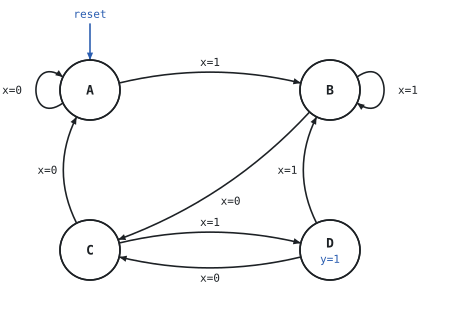

# 11.11 fsm_from_table

**New concept:** the full sequential machine from a table.

Now let the tools pick the encoding: declare an enum and transcribe the table.

**Coming from Verilog:** Same.

## Task

The machine from 11.9 as a real FSM with an enum state type. Output `y = '1'` in `D`. Active-high synchronous `reset` → `A`.



## Ports

```vhdl
entity top_module is
  port (
    clk, reset, x : in  std_logic;
    y             : out std_logic
  );
end entity top_module;
```

## Hints

<details><summary>Hint 1</summary>

Follow the two-process template from 11.1.

</details>

## Check

```
./check.py 11.11
```
