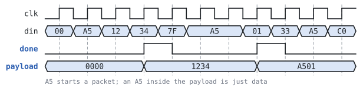

# 11.12 header_packet

**New concept:** byte-stream framing.

Many byte protocols mark the start of a packet with a header byte. The FSM hunts
for the header, then counts payload bytes regardless of their value: a payload
byte that happens to equal the header is still payload.

**Coming from Verilog:** Same.

## Task

One byte arrives on `din` per cycle and is sampled at each rising edge.

- While hunting, a byte equal to `x"A5"` starts a packet; any other byte is ignored.
- The next two bytes are payload, whatever their value.
- At the edge that samples the second payload byte, set `payload` to
  `first & second` (first byte in the upper half) and set `done`, which is high
  for exactly the next cycle. Then hunt again starting with the next byte.

`done` is `'0'` after every other edge; `payload` holds until the next packet.
Active-high synchronous `reset` → hunting, `payload = x"0000"`, `done = '0'`.



## Ports

```vhdl
entity top_module is
  port (
    clk, reset : in  std_logic;
    din        : in  std_logic_vector(7 downto 0);
    payload    : out std_logic_vector(15 downto 0);
    done       : out std_logic
  );
end entity top_module;
```

## Hints

<details><summary>Hint 1</summary>

States `HUNT`, `B1`, `B2`; keep the first payload byte in a register.

</details>

## Check

```
./check.py 11.12
```
