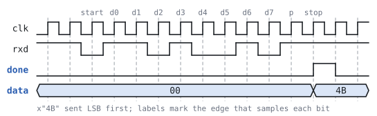

# 11.13 uart_rx_parity

**New concept:** extending a protocol FSM.

Adding a field to a frame means one more state. With **odd** parity, the 8 data
bits plus the parity bit contain an odd number of 1s.

The line `rxd` idles at `'1'` and carries one bit per clock (no oversampling): sample
it once at every rising edge.

**Coming from Verilog:** Same.

## Task

As 11.7, with an **odd** parity bit between the 8 data bits and the stop bit:
start, 8 data bits (LSB first), parity, stop.

- Stop bit `'1'` and parity correct: update `data` and pulse `done` as in 11.7.
- Stop bit `'1'` but parity wrong: don't touch `data` or `done`; go straight back
  to idle.
- Stop bit `'0'`: framing error, handled exactly as in 11.7 (wait for a `'1'`).

Active-high synchronous `reset` → idle, `data = x"00"`, `done = '0'`.



## Ports

```vhdl
entity top_module is
  port (
    clk, reset, rxd : in  std_logic;
    data            : out std_logic_vector(7 downto 0);
    done            : out std_logic
  );
end entity top_module;
```

The grader's frames include bad parity bits and bad stop bits.

## Hints

<details><summary>Hint 1</summary>

Start from your 11.7 solution and add a `PARITY` state; accumulate the XOR of the data bits as they arrive.

</details>

## Check

```
./check.py 11.13
```
