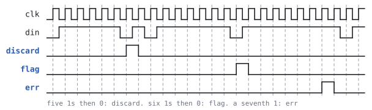

# 11.14 bit_unstuff

**New concept:** protocol FSM (HDLC-style bit stuffing).

HDLC marks frame boundaries with the flag `01111110`. To keep that pattern out of
the data, the sender inserts (*stuffs*) a `0` after every five consecutive `1`s;
the receiver removes it. Six `1`s in a row can only be a flag, and seven or more
is an error (or an abort).

**Coming from Verilog:** Same.

## Task

`din` is sampled at each rising edge. Count consecutive `1`s since the last `0`:

- a `0` after exactly five `1`s: `discard` (the `0` was stuffed)
- a `0` after exactly six `1`s: `flag`
- a seventh consecutive `1`: `err`; after that, ignore the input until a `0` is
  sampled (that `0` restarts counting, and is not a discard or a flag)

Each output is high for exactly the one cycle after the edge that completed its
pattern (Moore). A `0` that triggers `discard` or `flag` also restarts counting.
Active-high synchronous `reset` behaves as if a `0` had just been received.



## Ports

```vhdl
entity top_module is
  port (
    clk, reset, din    : in  std_logic;
    discard, flag, err : out std_logic
  );
end entity top_module;
```

## Hints

<details><summary>Hint 1</summary>

States for 0–6 ones seen, plus `S_DISC`, `S_FLAG`, `S_ERR` and an error-wait state. (A state called `ERR` would clash with the port `err`: VHDL names are case-insensitive.)

</details>

<details><summary>Hint 2</summary>

`S_DISC` and `S_FLAG` behave like "0 ones seen" for their next transition.

</details>

## Check

```
./check.py 11.14
```
