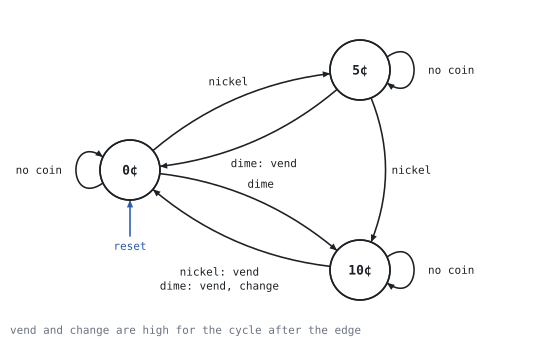

# 11.15 vending

**New concept:** an FSM whose states are amounts.

When the states represent an accumulated quantity, name them after the quantity
(`C0`, `C5`, `C10`). The transitions then read like arithmetic.

**Coming from Verilog:** Same.

## Task

Coins are sampled at each rising edge: `nickel` (5¢) or `dime` (10¢), never both
in the same cycle. The machine accumulates the total. At the edge where a coin
brings the total to 15¢ or more, set `vend` for exactly the next cycle, also set
`change` for that cycle if the total became 20¢, and return the total to 0¢.
Both outputs are `'0'` after every other edge. Active-high synchronous `reset` →
0¢, outputs `'0'`.



## Ports

```vhdl
entity top_module is
  port (
    clk, reset, nickel, dime : in  std_logic;
    vend, change             : out std_logic
  );
end entity top_module;
```

The grader never drives `nickel` and `dime` high together.

## Hints

<details><summary>Hint 1</summary>

Three amount states plus registered `vend`/`change`, or two extra output states.

</details>

## Check

```
./check.py 11.15
```
