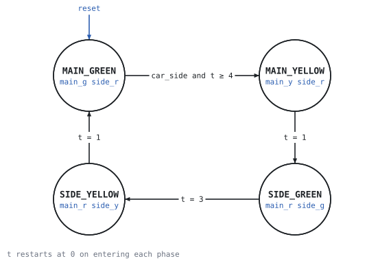

# 11.16 traffic_light

**New concept:** FSM with an internal timer.

Many FSMs stay in a state for a fixed time. A timer that restarts on every state
change keeps the timing logic out of the state type.

**Coming from Verilog:** Same.

## Task

Four phases, with a timer `t` that is 0 in the first cycle of every phase and
counts up by one each cycle:

| phase | lights on | leaves at the edge where |
|---|---|---|
| `MAIN_GREEN` | `main_g`, `side_r` | `car_side = '1'` and `t ≥ 4` (green for at least 5 cycles) |
| `MAIN_YELLOW` | `main_y`, `side_r` | `t = 1` (2 cycles) |
| `SIDE_GREEN` | `main_r`, `side_g` | `t = 3` (4 cycles) |
| `SIDE_YELLOW` | `main_r`, `side_y` | `t = 1` (2 cycles) |

The phases cycle in that order. All other light outputs are `'0'` (Moore).
Active-high synchronous `reset` → `MAIN_GREEN` with `t = 0`.

Don't name a state `MAIN_G`: VHDL is case-insensitive, so it would clash with the
port `main_g`.



## Ports

```vhdl
entity top_module is
  port (
    clk, reset, car_side                           : in  std_logic;
    main_g, main_y, main_r, side_g, side_y, side_r : out std_logic
  );
end entity top_module;
```

## Hints

<details><summary>Hint 1</summary>

In `MAIN_GREEN` the timer can saturate at 4; nothing needs it to count higher.

</details>

## Check

```
./check.py 11.16
```
