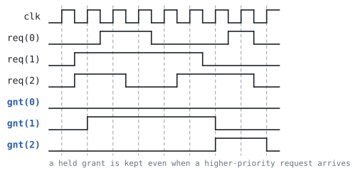

# 11.17 arbiter_fixed3

**New concept:** fixed-priority arbitration with grant hold.

An arbiter gives a shared resource to one requester at a time. With **grant
hold**, a requester keeps the grant until it lets go, even if someone with
higher priority asks in the meantime.

**Coming from Verilog:** Same.

## Task

Three requesters, `req(0)` highest priority. `gnt` is a registered one-hot vector
(or all zeros). At each rising edge:

- if a grant is held and that requester's `req` is still `'1'`, keep it
- otherwise grant the highest-priority requester whose `req` is `'1'` (lowest
  index), or nobody

Active-high synchronous `reset` → no grant.



## Ports

```vhdl
entity top_module is
  port (
    clk, reset : in  std_logic;
    req        : in  std_logic_vector(2 downto 0);
    gnt        : out std_logic_vector(2 downto 0)
  );
end entity top_module;
```

## Hints

<details><summary>Hint 1</summary>

`if (gnt and req) /= "000" then` keeps the current grant.

</details>

## Check

```
./check.py 11.17
```
