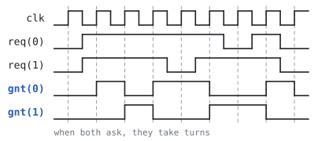

# 11.18 arbiter_rr2

**New concept:** round-robin fairness.

A round-robin arbiter remembers who it served last and gives the other requester
priority next time, so nobody starves.

**Coming from Verilog:** Same.

## Task

Two requesters. `gnt` is registered and recomputed at every rising edge from the
current `req`, so each grant lasts one cycle:

- only one requester: grant it
- both: grant the one that was **not** granted most recently
- neither: no grant

"Most recently granted" is updated on every edge that grants somebody. After
reset, requester 0 wins the first tie. Active-high synchronous `reset` → no
grant.



## Ports

```vhdl
entity top_module is
  port (
    clk, reset : in  std_logic;
    req        : in  std_logic_vector(1 downto 0);
    gnt        : out std_logic_vector(1 downto 0)
  );
end entity top_module;
```

## Hints

<details><summary>Hint 1</summary>

One extra flag remembers who was granted last; reset it as if requester 1 had just been served.

</details>

## Check

```
./check.py 11.18
```
