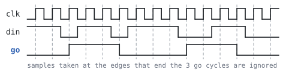

# 11.19 detect_then_enable

**New concept:** chaining a detector FSM with a fixed-length action.

A common structure: an FSM hunts for a trigger, performs a fixed-length action,
then starts hunting again. During the action the input is ignored.

**Coming from Verilog:** Same.

## Task

`din` is sampled at each rising edge. When the last three samples are `1, 1, 0`
(oldest first), `go` is `'1'` for exactly the next 3 cycles (Moore). Samples taken
at the edges that end those 3 cycles are ignored; after that the search starts
from scratch. Overlap with bits before the trigger is allowed (e.g. `1110`
triggers). Active-high synchronous `reset` → searching from scratch.



## Ports

```vhdl
entity top_module is
  port (
    clk, reset, din : in  std_logic;
    go              : out std_logic
  );
end entity top_module;
```

## Hints

<details><summary>Hint 1</summary>

Search states for nothing, `1`, `11`, then three `GO` states.

</details>

## Check

```
./check.py 11.19
```
