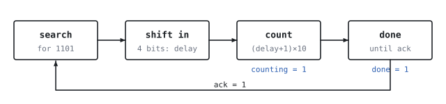

# 11.20 timer_unit

**New concept:** a full control unit made of a detector, a shift-in, a counter, and an ack handshake.

Bigger controllers are several small machines in sequence. Write each phase as a
group of states, and give the datapath (shift register, counters) its own
registers.

**Coming from Verilog:** Same.

## Task

`din` and `ack` are sampled at each rising edge.

1. **Search** for `1, 1, 0, 1` on `din` (overlapping matches allowed while searching).
2. **Shift in** the next 4 samples of `din`, MSB first, as `delay`.
3. **Count** for `(delay + 1) × 10` cycles with `counting = '1'`. During the first 10
   of those cycles `remaining = delay`, during the next 10 `remaining = delay - 1`,
   …, during the last 10 `remaining = 0`.
4. **Done**: `done = '1'` until an edge samples `ack = '1'`; then go back to
   searching from scratch.

`counting` and `done` are Moore outputs. `remaining` is `"0000"` whenever
`counting = '0'`. Active-high synchronous `reset` → searching from scratch.



## Ports

```vhdl
entity top_module is
  port (
    clk, reset, din, ack : in  std_logic;
    counting, done       : out std_logic;
    remaining            : out std_logic_vector(3 downto 0)
  );
end entity top_module;
```

## Hints

<details><summary>Hint 1</summary>

Two counters while counting: `remaining` (tens) and a 0–9 sub-counter.

</details>

<details><summary>Hint 2</summary>

The count phase ends at the edge where the sub-counter is 9 and `remaining` is 0.

</details>

## Check

```
./check.py 11.20
```
