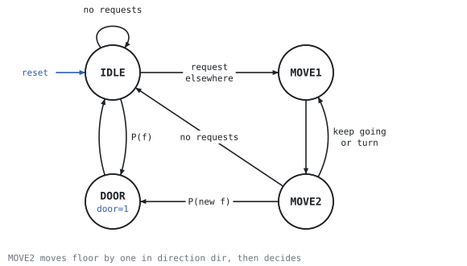

# 11.21 elevator3

**New concept:** request latching, direction preference, and a precise spec.

Controllers with "nearest", "prefer" and "while" in their description are easy to
get almost right. Before writing any VHDL, make sure the spec answers every
*what happens if…* question. This one tries to.

**Coming from Verilog:** Same.

## Task

A car serves floors 0–2. State: `floor`, a 3-bit pending-request set `p`, a
direction `dir` (`UP` or `DOWN`), and a phase `IDLE`, `DOOR`, `MOVE1` or `MOVE2`.

At every rising edge, first merge new calls: `P = p or call`. Then, by phase:

- **IDLE**: run *decide* (below) at the current floor.
- **DOOR**: go to `IDLE`; `p ← P` with the current floor's bit cleared (a call for
  the floor whose door is open is served by that opening).
- **MOVE1**: go to `MOVE2`; `p ← P`.
- **MOVE2**: `floor` moves one floor in direction `dir`, then run *decide* at the
  new floor.

*decide* at floor `f`, in this order:

1. `P(f) = '1'`: go to `DOOR`, `p ← P` with bit `f` cleared.
2. there is a request in direction `dir` (above `f` for `UP`, below for `DOWN`):
   go to `MOVE1`, `p ← P`.
3. there is a request in the other direction: flip `dir`, go to `MOVE1`, `p ← P`.
4. otherwise go to `IDLE`, `p ← P` (which is all zeros here).

Outputs (Moore): `floor` as a binary number, `door = '1'` in `DOOR`.
Active-high synchronous `reset` → floor 0, `p = "000"`, `dir = UP`, `IDLE`.

So a move takes 2 cycles per floor, a stop adds one `DOOR` cycle and one `IDLE`
cycle, and the car never stops at a floor nobody asked for.



## Ports

```vhdl
entity top_module is
  port (
    clk, reset : in  std_logic;
    call       : in  std_logic_vector(2 downto 0);
    floor      : out std_logic_vector(1 downto 0);
    door       : out std_logic
  );
end entity top_module;
```

## Hints

<details><summary>Hint 1</summary>

Write *decide* as a procedure (or just repeat it) used in both `IDLE` and `MOVE2`.

</details>

<details><summary>Hint 2</summary>

Keep `p` as a `std_logic_vector(2 downto 0)` and the floor as an integer `0 to 2`.

</details>

## Check

```
./check.py 11.21
```
