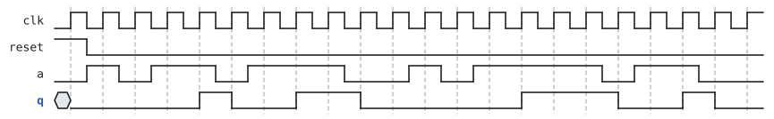

# 11.22 wave_puzzle_seq1

**New concept:** reverse-engineering a sequential circuit from a waveform.

7.15 recovered a truth table from a trace. With a clock, an output can depend on
earlier inputs too, so read the waveform edge by edge: at each rising edge, which
inputs (now and at earlier edges) decide what `q` becomes?

**Coming from Verilog:** Nothing language-specific here.

## Task

Build the circuit that produced this waveform. `reset` is synchronous and active
high, and clears everything. The waveform was drawn by simulating the reference
answer, so it is exact.



## Ports

```vhdl
entity top_module is
  port (
    clk, reset, a : in  std_logic;
    q             : out std_logic
  );
end entity top_module;
```

## Hints

<details><summary>Hint 1</summary>

Find the edges where `q` becomes 1. What was `a` at that edge, and at the edge before?

</details>

<details><summary>Hint 2</summary>

One flip-flop remembers the previous `a`, a second one is `q`.

</details>

## Check

```
./check.py 11.22
```
