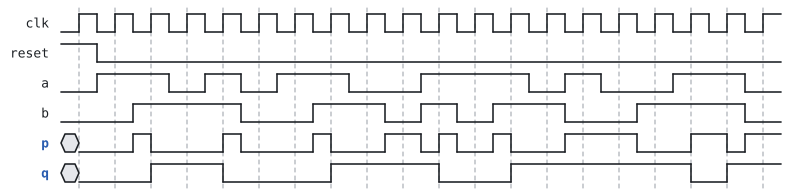

# 11.23 wave_puzzle_seq2

**New concept:** telling registered outputs from combinational ones in a waveform.

An output that changes only at rising edges is registered. One that also changes
when an input does, between edges, is (at least partly) combinational: a Mealy
output.

**Coming from Verilog:** Nothing language-specific here.

## Task

Build the circuit that produced this waveform: one output is a flip-flop and the
other is combinational. `reset` is synchronous and active high, and clears the
flip-flop.



## Ports

```vhdl
entity top_module is
  port (
    clk, reset, a, b : in  std_logic;
    p, q             : out std_logic
  );
end entity top_module;
```

## Hints

<details><summary>Hint 1</summary>

`q` only moves at rising edges. At which edges does it change, and what are `a` and `b` there?

</details>

<details><summary>Hint 2</summary>

`p` changes whenever `b` or `q` does. Compare `p` with `q` while `b = 0`, then while `b = 1`.

</details>

## Check

```
./check.py 11.23
```
