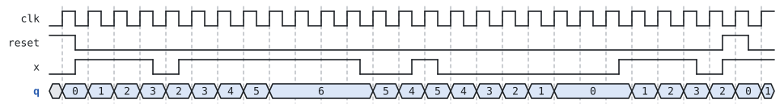

# 11.24 wave_puzzle_seq3

**New concept:** reverse-engineering a counter from a waveform.

Bus values in a waveform are often counts. Look at how the value moves from edge to
edge, and pay attention to what happens at the ends of its range.

**Coming from Verilog:** Nothing language-specific here.

## Task

Build the circuit that produced this waveform (values of `q` are shown in decimal).
`reset` is synchronous and active high, and sets `q` to 0.



## Ports

```vhdl
entity top_module is
  port (
    clk, reset, x : in  std_logic;
    q             : out std_logic_vector(2 downto 0)
  );
end entity top_module;
```

## Hints

<details><summary>Hint 1</summary>

Which way does `q` move when `x = 1`? When `x = 0`?

</details>

<details><summary>Hint 2</summary>

`q` never goes below 0, and never above one particular value: it saturates instead of wrapping.

</details>

## Check

```
./check.py 11.24
```
