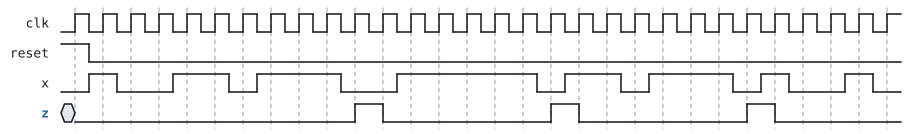

# 11.25 wave_puzzle_seq4

**New concept:** reverse-engineering a small state machine from a waveform.

A state machine shows up in a waveform as an output that depends on *how* the
inputs got where they are. Line up each pulse of the output with the history of
the input just before it.

**Coming from Verilog:** Nothing language-specific here.

## Task

Build the circuit that produced this waveform. `z` is a Moore output (it changes
only at rising edges). `reset` is synchronous and active high.



## Ports

```vhdl
entity top_module is
  port (
    clk, reset, x : in  std_logic;
    z             : out std_logic
  );
end entity top_module;
```

## Hints

<details><summary>Hint 1</summary>

`z` pulses right after `x` falls, but not every time. Count how many edges `x` was high before each fall.

</details>

<details><summary>Hint 2</summary>

Count consecutive edges with `x = 1`, saturating at the threshold you found; check the count when `x` is 0.

</details>

## Check

```
./check.py 11.25
```
