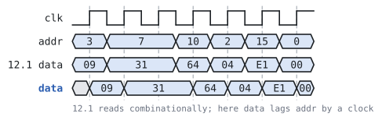

# 12.2 rom_sync

**New concept:** registered ROM read: the style that maps to block RAM.

FPGA block RAMs have a registered read port: you present the address before the
clock edge and get the data after it. Describing the ROM with a registered output
lets synthesis map it into a block RAM instead of LUTs.

**Coming from Verilog:** Same as reading a `reg` array inside `always @(posedge clk)`.

## Task

The ROM from 12.1 with a registered (1-cycle) read: at each rising edge, `data` takes the word at `addr`. No reset.



## Ports

```vhdl
entity top_module is
  port (
    clk  : in  std_logic;
    addr : in  std_logic_vector(3 downto 0);
    data : out std_logic_vector(7 downto 0)
  );
end entity top_module;
```

## Hints

<details><summary>Hint 1</summary>

The same constant array, read inside `if rising_edge(clk)`.

</details>

## Check

```
./check.py 12.2
```
