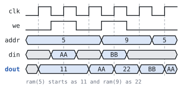

# 12.3 ram_sp

**New concept:** array-of-vector `signal` as RAM; read-first vs. write-first.

A RAM is an array **signal** written in a clocked process. With a synchronous read
in the same process, the order of the statements doesn't matter: the read sees the
array as it was *before* this edge, because signals update after the process
suspends. That's **read-first** behavior.

```vhdl
if rising_edge(clk) then
  if wr = '1' then
    mem(to_integer(unsigned(a))) <= wdata;
  end if;
  rdata <= mem(to_integer(unsigned(a)));     -- old contents
end if;
```

The stub declares the RAM initialized to zeros so the grader can compare reads of
never-written addresses.

**Coming from Verilog:** Same as nonblocking reads and writes of a `reg` array.

## Task

32×8 single-port RAM `ram`. At each rising edge, if `we = '1'` write `din` at
`addr`. `dout` is a synchronous read of `addr`, **read-first**: during a write it
returns the old contents.



## Ports

```vhdl
entity top_module is
  port (
    clk, we : in  std_logic;
    addr    : in  std_logic_vector(4 downto 0);
    din     : in  std_logic_vector(7 downto 0);
    dout    : out std_logic_vector(7 downto 0)
  );
end entity top_module;
```

## Hints

<details><summary>Hint 1</summary>

Exactly the process above.

</details>

## Check

```
./check.py 12.3
```
