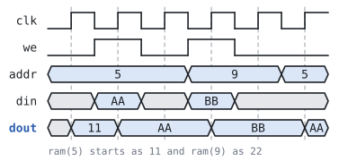

# 12.4 ram_write_first

**New concept:** write-first read-during-write behavior.

Block RAMs can be configured to return the *new* data during a write
(**write-first**). To describe it, read `din` instead of the array when writing:

```vhdl
if wr = '1' then
  mem(i) <= wdata;
  rdata  <= wdata;
else
  rdata  <= mem(i);
end if;
```

(A shared `variable` for the RAM would also produce write-first behavior, but
shared variables in RTL are best avoided.)

**Coming from Verilog:** Same idea; nonblocking assignments alone give read-first.

## Task

Same as 12.3, but **write-first**: during a write, `dout` shows the new data.



## Ports

```vhdl
entity top_module is
  port (
    clk, we : in  std_logic;
    addr    : in  std_logic_vector(4 downto 0);
    din     : in  std_logic_vector(7 downto 0);
    dout    : out std_logic_vector(7 downto 0)
  );
end entity top_module;
```

## Hints

<details><summary>Hint 1</summary>

An `if we = '1' ... else ...` around the read.

</details>

## Check

```
./check.py 12.4
```
