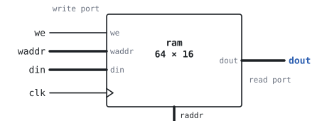

# 12.5 ram_dp

**New concept:** simple dual-port RAM: independent write and read addresses.

A **simple dual-port** RAM has one write port and one read port with separate
addresses, both on the same clock. This is the building block of FIFOs.

**Coming from Verilog:** Same.

## Task

64×16 RAM. At each rising edge, if `we = '1'` write `din` at `waddr`, and
`dout` takes the word at `raddr`. Reading the address being written returns the
old data. The RAM starts as all zeros.



## Ports

```vhdl
entity top_module is
  port (
    clk, we      : in  std_logic;
    waddr, raddr : in  std_logic_vector(5 downto 0);
    din          : in  std_logic_vector(15 downto 0);
    dout         : out std_logic_vector(15 downto 0)
  );
end entity top_module;
```

## Hints

<details><summary>Hint 1</summary>

One clocked process with an indexed write and an indexed read.

</details>

## Check

```
./check.py 12.5
```
