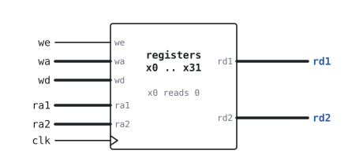

# 12.6 regfile_rv

**New concept:** a RISC-V register file (x0 hard-wired to zero).

A CPU register file has two read ports (for `rs1` and `rs2`) and one write port.
Reads are combinational so an instruction gets its operands in the same cycle.
In RISC-V, register `x0` always reads as zero and ignores writes.

**Coming from Verilog:** Same.

## Task

32 registers of 32 bits. `rd1` and `rd2` are combinational reads of registers
`ra1` and `ra2`. At each rising edge, if `we = '1'` and `wa ≠ 0`, register `wa`
takes `wd`. Register 0 always reads as zero. Active-high synchronous `reset`
clears every register.



## Ports

```vhdl
entity top_module is
  port (
    clk, reset, we : in  std_logic;
    ra1, ra2, wa   : in  std_logic_vector(4 downto 0);
    wd             : in  std_logic_vector(31 downto 0);
    rd1, rd2       : out std_logic_vector(31 downto 0)
  );
end entity top_module;
```

## Hints

<details><summary>Hint 1</summary>

An array of 32 vectors; the write is guarded by `wa /= "00000"`, so register 0 stays zero after reset.

</details>

## Check

```
./check.py 12.6
```
