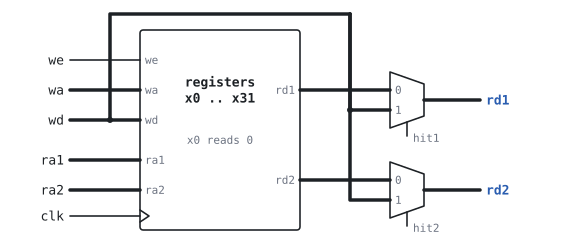

# 12.7 regfile_bypass

**New concept:** write-through bypass (forwarding).

In a pipelined CPU, an instruction may read a register in the same cycle another
instruction writes it. Without forwarding it would see the old value. A
**bypass** compares the read and write addresses and forwards the write data.

**Coming from Verilog:** Same.

## Task

Same as 12.6, but a read of the register being written **this cycle** returns
`wd`: when `we = '1'`, `wa ≠ 0` and `ra1 = wa`, `rd1 = wd` (likewise for `rd2`).
Register 0 still always reads as zero.



## Ports

```vhdl
entity top_module is
  port (
    clk, reset, we : in  std_logic;
    ra1, ra2, wa   : in  std_logic_vector(4 downto 0);
    wd             : in  std_logic_vector(31 downto 0);
    rd1, rd2       : out std_logic_vector(31 downto 0)
  );
end entity top_module;
```

## Hints

<details><summary>Hint 1</summary>

Two comparators and two muxes in front of the 12.6 read ports.

</details>

## Check

```
./check.py 12.7
```
