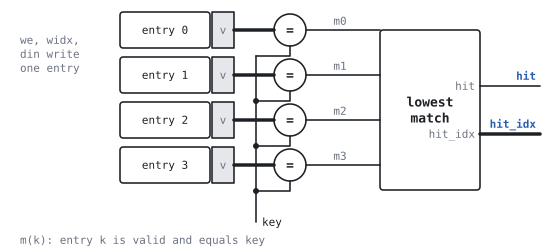

# 12.8 cam4

**New concept:** content-addressable lookup.

A **CAM** answers "where is this value?" instead of "what is at this address?".
Every entry compares against the key in parallel, and a priority encoder picks a
match. Caches, TLBs and network lookups use them.

**Coming from Verilog:** Same.

## Task

4 entries of 8 bits, each with a valid flag. At each rising edge, if `we = '1'`,
entry `widx` takes `din` and becomes valid. Combinationally, `hit = '1'` when
`key` equals some **valid** entry, and `hit_idx` is the lowest such index
(`"00"` when there's no hit). Active-high synchronous `reset` invalidates all
entries.



## Ports

```vhdl
entity top_module is
  port (
    clk, reset, we : in  std_logic;
    widx           : in  std_logic_vector(1 downto 0);
    din, key       : in  std_logic_vector(7 downto 0);
    hit            : out std_logic;
    hit_idx        : out std_logic_vector(1 downto 0)
  );
end entity top_module;
```

The grader keeps `din` and `key` in 0–11 so that hits are common.

## Hints

<details><summary>Hint 1</summary>

A `for` loop from 3 down to 0 that overwrites the result leaves the lowest matching index.

</details>

## Check

```
./check.py 12.8
```
