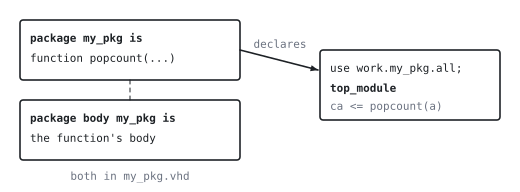

# 13.2 package_function

**New concept:** package declaration vs. package body.

A package that contains subprograms has two parts. The **declaration** lists what
users can see (the function's signature); the **package body** holds the
implementation:

```vhdl
package util_pkg is
  function max(a, b : integer) return integer;
end package util_pkg;

package body util_pkg is
  function max(a, b : integer) return integer is
  begin
    if a > b then return a; end if;
    return b;
  end function max;
end package body util_pkg;
```

Changing only the body doesn't force users of the package to recompile.

This problem has more than one file you edit. The grader compiles every listed file,
packages (`*_pkg.vhd`) first, then `top_module.vhd`.

**Coming from Verilog:** Like a SystemVerilog `package` with functions, split into interface and implementation.

## Task

In `my_pkg.vhd`, declare and implement
`function popcount(v : std_logic_vector) return natural`. Use it in
`top_module` to output the popcount of `a` on `ca` and of `b` on `cb`.



## Ports

```vhdl
entity top_module is
  port (
    a  : in  std_logic_vector(15 downto 0);
    b  : in  std_logic_vector(7 downto 0);
    ca : out std_logic_vector(4 downto 0);
    cb : out std_logic_vector(3 downto 0)
  );
end entity top_module;
```

## Hints

<details><summary>Hint 1</summary>

`ca <= std_logic_vector(to_unsigned(popcount(a), 5));`

</details>

## Check

```
./check.py 13.2
```
