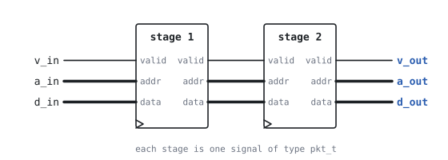

# 13.3 record_signal

**New concept:** `record` types for grouping pipeline fields.

A **record** groups fields of different types into one object. A pipeline stage
then becomes one signal, and one assignment moves the whole bundle forward:

```vhdl
type beat_t is record
  valid : std_logic;
  last  : std_logic;
  data  : std_logic_vector(31 downto 0);
end record;

constant BEAT_NONE : beat_t := (valid => '0', last => '0', data => (others => '0'));

signal s1, s2 : beat_t;
...
s2 <= s1;               -- every field at once
dout <= s2.data;        -- select a field with a dot
```

Top-level ports stay plain vectors (the grader only supports those), but inside a
design records are everywhere.

This problem has more than one file you edit. The grader compiles every listed file,
packages (`*_pkg.vhd`) first, then `top_module.vhd`.

**Coming from Verilog:** SystemVerilog `struct packed` is the closest equivalent; plain Verilog has nothing like it.

## Task

In `my_pkg.vhd`, declare

```vhdl
type pkt_t is record
  valid : std_logic;
  addr  : std_logic_vector(3 downto 0);
  data  : std_logic_vector(7 downto 0);
end record;
```

In `top_module`, register the inputs (`v_in`, `a_in`, `d_in`) into a `pkt_t`
stage 1 at each rising edge, then stage 1 into stage 2, and drive the outputs
from stage 2's fields. Active-high synchronous `reset` clears both stages to all
zeros.



## Ports

```vhdl
entity top_module is
  port (
    clk, reset, v_in : in  std_logic;
    a_in             : in  std_logic_vector(3 downto 0);
    d_in             : in  std_logic_vector(7 downto 0);
    v_out            : out std_logic;
    a_out            : out std_logic_vector(3 downto 0);
    d_out            : out std_logic_vector(7 downto 0)
  );
end entity top_module;
```

## Hints

<details><summary>Hint 1</summary>

`s1 <= (valid => v_in, addr => a_in, data => d_in);` builds a record from an aggregate.

</details>

## Check

```
./check.py 13.3
```
