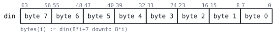

# 13.4 array_of_vectors

**New concept:** declaring `type word_array is array (natural range <>) of slv(7 downto 0)`.

An **array of vectors** is a 2-D structure: an array whose elements are
`std_logic_vector`s. Declaring the index range as `natural range <>` makes the
type unconstrained, so each signal or variable picks its own size:

```vhdl
type word_array is array (natural range <>) of std_logic_vector(15 downto 0);
signal taps : word_array(0 to 3);
...
taps(2)(15) <= '1';      -- element 2, bit 15
```

**Coming from Verilog:** Like a Verilog memory `reg [7:0] b [0:7]`, but it's a real type you can pass to functions.

## Task

Unpack the 64-bit `din` into 8 bytes (byte `i` is `din(8*i+7 downto 8*i)`) held in
an array of vectors. Output the largest byte (unsigned) on `maxv` and its index on
`maxi`. If several bytes share the maximum, report the lowest index.



## Ports

```vhdl
entity top_module is
  port (
    din  : in  std_logic_vector(63 downto 0);
    maxv : out std_logic_vector(7 downto 0);
    maxi : out std_logic_vector(2 downto 0)
  );
end entity top_module;
```

The grader biases `din` toward bytes with many 1s, so ties for the maximum are common.

## Hints

<details><summary>Hint 1</summary>

Only replace the running maximum when a byte is strictly greater; that keeps the lowest index on ties.

</details>

## Check

```
./check.py 13.4
```
