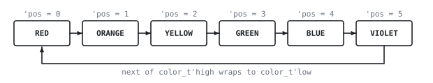

# 13.5 enum_attributes

**New concept:** `'pos`, `'val`, `'high`, and `'length` attributes.

Every scalar type comes with attributes:

| attribute | meaning |
|---|---|
| `T'pos(x)` | position number of value `x` (first value is 0) |
| `T'val(n)` | the value at position `n` |
| `T'low`, `T'high` | first and last values |
| `T'succ(x)`, `T'pred(x)` | next / previous value (error past the ends) |

```vhdl
type day_t is (MON, TUE, WED, THU, FRI);
...
n := day_t'pos(WED);          -- 2
d := day_t'val(4);            -- FRI
```

**Coming from Verilog:** No equivalent; Verilog has no enumerated types (SystemVerilog `enum` has `.next()`).

## Task

Declare `type color_t is (RED, ORANGE, YELLOW, GREEN, BLUE, VIOLET)`. Map input
index 0–5 to the color, then output on `nxt` the **next** color's index, wrapping
`VIOLET` → `RED`. Use `'pos`, `'val` and `'high` rather than a `case` statement.
Inputs 6 and 7 output 0.



## Ports

```vhdl
entity top_module is
  port (
    idx : in  std_logic_vector(2 downto 0);
    nxt : out std_logic_vector(2 downto 0)
  );
end entity top_module;
```

## Hints

<details><summary>Hint 1</summary>

Guard against 6 and 7 before calling `'val`, or you'll get a runtime range error.

</details>

<details><summary>Hint 2</summary>

`if c = color_t'high then` handles the wrap.

</details>

## Check

```
./check.py 13.5
```
