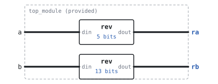

# 13.6 unconstrained_ports

**New concept:** unconstrained `slv` ports and `'range`/`'length` inside the architecture.

A port declared as plain `std_logic_vector` (no range) is **unconstrained**: each
instance gets its width from whatever is connected. Inside the architecture, use
attributes instead of fixed numbers:

```vhdl
entity invert is
  port (din : in std_logic_vector; dout : out std_logic_vector);
end entity;
architecture rtl of invert is
begin
  dout <= not din;
end architecture;
```

Don't assume the range is `N downto 0`: someone may connect a slice like
`x(12 downto 5)`. Index relative to `din'low`/`din'high`.

This problem has two files. `top_module.vhd` is already written: it instantiates
your `rev` entity at widths 5 and 13. You only edit `rev.vhd`.

**Coming from Verilog:** Verilog needs a parameter for the width. VHDL can infer it from the connection.

## Task

In `rev.vhd`, complete entity `rev` (unconstrained `din`/`dout`, same length) so
that it reverses bit order for any width: the bit at `din'high` goes to
`dout'low`, and so on. The provided `top_module` connects `a → ra` and `b → rb`.



## Ports

```vhdl
entity top_module is
  port (
    a  : in  std_logic_vector(4 downto 0);
    b  : in  std_logic_vector(12 downto 0);
    ra : out std_logic_vector(4 downto 0);
    rb : out std_logic_vector(12 downto 0)
  );
end entity top_module;
```

## Hints

<details><summary>Hint 1</summary>

A `for i in 0 to din'length - 1 generate` loop.

</details>

<details><summary>Hint 2</summary>

`dout(dout'low + i) <= din(din'high - i);`

</details>

## Check

```
./check.py 13.6
```
