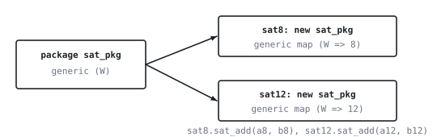

# 13.7 generic_package

**New concept:** a package with a `generic` clause, instantiated for different widths.

VHDL-2008 packages can have generics. The generic package is a template; a
**package instantiation** fixes the generics and creates a real package. You can
instantiate it in an architecture's declarative region:

```vhdl
package fifo_pkg is
  generic (DEPTH : positive);
  constant ADDR_BITS : natural := ...;
end package fifo_pkg;

-- in an architecture:
package fifo16 is new work.fifo_pkg generic map (DEPTH => 16);
...
signal ptr : unsigned(fifo16.ADDR_BITS - 1 downto 0);
```

Items from an instance are reached with a selected name (`fifo16.ADDR_BITS`).

This problem has more than one file you edit. The grader compiles every listed file,
packages (`*_pkg.vhd`) first, then `top_module.vhd`.

**Coming from Verilog:** No Verilog equivalent. SystemVerilog parameterized classes are the nearest idea.

## Task

In `sat_pkg.vhd`, write a generic package `sat_pkg` with `generic (W : positive)`
and a function `sat_add(a, b : signed(W - 1 downto 0)) return signed` that adds
two `W`-bit signed values and clamps to the most positive or most negative `W`-bit
value instead of wrapping.

In `top_module`, instantiate it for `W = 8` and `W = 12`, and output
`s8 = sat_add(a8, b8)` and `s12 = sat_add(a12, b12)` (all signed).



## Ports

```vhdl
entity top_module is
  port (
    a8, b8   : in  std_logic_vector(7 downto 0);
    s8       : out std_logic_vector(7 downto 0);
    a12, b12 : in  std_logic_vector(11 downto 0);
    s12      : out std_logic_vector(11 downto 0)
  );
end entity top_module;
```

## Hints

<details><summary>Hint 1</summary>

Add one bit wider; overflow happened if the top two bits of the wide sum differ.

</details>

<details><summary>Hint 2</summary>

An `others` aggregate needs a known width: build the clamp value in a `signed(W - 1 downto 0)` variable.

</details>

## Check

```
./check.py 13.7
```
