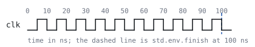

# 14.1 clock_gen

**New concept:** a clock process with `wait for`.

A testbench is an entity with no ports. Inside it, simulation-only constructs are
fine: `wait for` delays, `after` clauses, file I/O.

Two common ways to make a clock:

```vhdl
sys_clk <= not sys_clk after 4 ns;          -- needs an initial value on the signal

process
begin
  sys_clk <= '0'; wait for 4 ns;
  sys_clk <= '1'; wait for 4 ns;
end process;
```

A testbench ends with `std.env.finish` (VHDL-2008) in some process; otherwise a
free-running clock keeps the simulation going forever.

**How this is graded:** the grader runs your `tb` with the provided `monitor`, which
logs every change of its inputs, and compares the log against the reference
testbench's log. Only the final value at each instant counts, so it doesn't matter
how many delta cycles your assignments take. Your simulation must end at the same
time via `std.env.finish`.

**Coming from Verilog:** `always #5 clk = ~clk;` becomes `clk <= not clk after 5 ns;`, and `$finish` becomes `std.env.finish`.

## Task

Write entity `tb` that generates `clk` with a 10 ns period, starting at `'0'` at
time 0 (so it rises at 5 ns, 15 ns, …). Connect it to the monitor and end the
simulation at 100 ns with `std.env.finish`.



## Provided

```vhdl
entity monitor is
  port (clk : in std_logic);
end entity monitor;
```

Instantiate it with `mon: entity work.monitor port map (clk => clk);`.

## Hints

<details><summary>Hint 1</summary>

Declare `signal clk : std_logic := '0';`.

</details>

<details><summary>Hint 2</summary>

A separate process: `wait for 100 ns; std.env.finish;`.

</details>

## Check

```
./check.py 14.1
```
