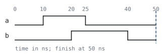

# 14.2 stimulus_timeline

**New concept:** a sequential stimulus process.

A stimulus process is a script: assign, wait, assign, wait. Each `wait for` is
relative to the current time.

```vhdl
process
begin
  start <= '0';
  wait for 20 ns;
  start <= '1';
  wait for 10 ns;
  start <= '0';
  wait;                      -- a bare wait suspends forever
end process;
```

**How this is graded:** the grader runs your `tb` with the provided `monitor`, which
logs every change of its inputs, and compares the log against the reference
testbench's log. Only the final value at each instant counts, so it doesn't matter
how many delta cycles your assignments take. Your simulation must end at the same
time via `std.env.finish`.

**Coming from Verilog:** An `initial` block with `#` delays. Note that `wait for 10 ns` is relative, like `#10`.

## Task

Drive `a` and `b` (connected to the monitor) through this timeline, then call
`std.env.finish` at 50 ns:

| time | change |
|---|---|
| 0 ns | `a = '0'`, `b = '0'` |
| 10 ns | `a = '1'` |
| 20 ns | `b = '1'` |
| 25 ns | `a = '0'` |
| 40 ns | `b = '0'` |
| 50 ns | end |



## Provided

```vhdl
entity monitor is
  port (a, b : in std_logic);
end entity monitor;
```

## Hints

<details><summary>Hint 1</summary>

Waits are relative: from 20 ns to 25 ns is `wait for 5 ns`.

</details>

## Check

```
./check.py 14.2
```
