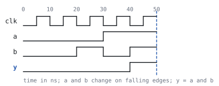

# 14.3 tb_instance

**New concept:** instantiating a DUT and driving it from a clock.

A typical testbench instantiates the design under test (DUT), generates a clock,
and changes inputs on the falling edge so they're stable at the rising edge.
`wait until falling_edge(clk);` synchronizes a stimulus process to the clock.

**How this is graded:** the grader runs your `tb` with the provided `monitor`, which
logs every change of its inputs, and compares the log against the reference
testbench's log. Only the final value at each instant counts, so it doesn't matter
how many delta cycles your assignments take. Your simulation must end at the same
time via `std.env.finish`.

**Coming from Verilog:** `@(negedge clk)` becomes `wait until falling_edge(clk);`.

## Task

Instantiate the provided `and2` and the monitor. Generate `clk` with a 10 ns period
starting at `'0'` (first falling edge at 10 ns). `a` and `b` start at `'0'`. On
each of the first four falling edges drive `ab` = `00`, `01`, `10`, `11` (that is,
`a = '0', b = '1'` on the second edge, and so on). Call `std.env.finish` at the
fifth falling edge (50 ns). Connect `a`, `b` and the AND output `y` to the
monitor (not the clock).



## Provided

```vhdl
entity and2 is
  port (a, b : in std_logic; y : out std_logic);
end entity and2;

entity monitor is
  port (a, b, y : in std_logic);
end entity monitor;
```

## Hints

<details><summary>Hint 1</summary>

A loop over the four values, each preceded by `wait until falling_edge(clk);`.

</details>

## Check

```
./check.py 14.3
```
