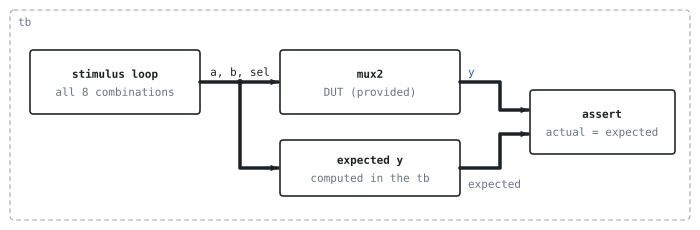

# 14.4 assert_basics

**New concept:** `assert cond report "msg" severity error`.

A self-checking testbench compares the DUT against the expected value and
complains when they differ:

```vhdl
assert parity_out = expected
  report "parity wrong for " & to_string(din)
  severity error;
```

`severity error` prints the message and continues; `severity failure` stops the
simulation. Remember the assertion fires when the condition is **false**.

To test all inputs of a small combinational block, loop over every combination
and wait a little after each so the outputs settle:

```vhdl
for i in 0 to 7 loop
  vec <= std_logic_vector(to_unsigned(i, 3));
  wait for 1 ns;
  ...
end loop;
```

**How this is graded:** the grader runs your `tb` once with the correct design, where
it must not report any `error` or `failure`, and once with each of several buggy
*mutants* of the design, where it must report at least one. Mutants your testbench
doesn't catch are listed as SURVIVED.

**Coming from Verilog:** SystemVerilog `assert (cond) else $error("msg");` is the closest equivalent.

## Task

Write an exhaustive self-checking testbench for the provided `mux2` (`y = b` when `sel = '1'`, else `a`). Check all 8 input combinations.



## Provided

```vhdl
entity mux2 is
  port (a, b, sel : in std_logic; y : out std_logic);
end entity mux2;
```

There are 3 mutants.

## Hints

<details><summary>Hint 1</summary>

Loop `i` over 0–7, split it into `a`, `b`, `sel`, wait 1 ns, and assert.

</details>

## Check

```
./check.py 14.4
```
