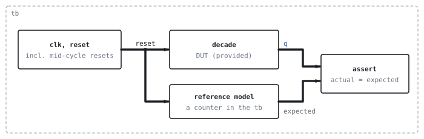

# 14.5 tb_counter

**New concept:** a clocked self-checking testbench with a reference model in the testbench.

For sequential designs, keep a **reference model** in the testbench: a variable
that you update exactly as the DUT should, and compare after each clock edge.
Check outputs away from the clock edges (e.g. just before the next rising edge),
when they're stable.

Don't only test the happy path: assert reset at different times, hold it for
several cycles, run long enough to wrap.

**How this is graded:** the grader runs your `tb` once with the correct design, where
it must not report any `error` or `failure`, and once with each of several buggy
*mutants* of the design, where it must report at least one. Mutants your testbench
doesn't catch are listed as SURVIVED.

**Coming from Verilog:** Same idea as a scoreboard in a Verilog testbench.

## Task

Test the provided `decade` counter: it counts 0–9 and wraps, with an active-high
**synchronous** `reset` to 0. Your testbench must catch all mutants, including one
whose reset acts asynchronously.



## Provided

```vhdl
entity decade is
  port (clk, reset : in std_logic; q : out std_logic_vector(3 downto 0));
end entity decade;
```

There are 4 mutants.

## Hints

<details><summary>Hint 1</summary>

Start with reset high for a couple of cycles: `q` is `'U'` until the first reset edge.

</details>

<details><summary>Hint 2</summary>

To catch the async mutant, change `reset` in the middle of a cycle and check `q` hasn't changed yet.

</details>

## Check

```
./check.py 14.5
```
