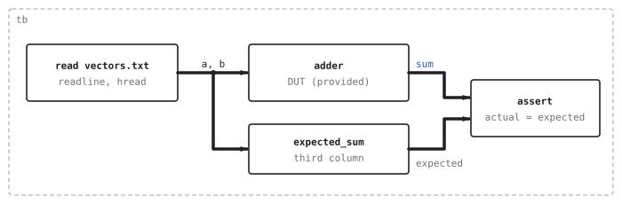

# 14.6 tb_textio

**New concept:** `std.textio` / `ieee.std_logic_textio`, reading vectors from a file.

Test vectors often come from a file produced by a reference model. `std.textio`
reads text line by line: `readline` fetches a line, then `read`/`hread` parse
values from it. In VHDL-2008, `hread` and `read` for `std_logic_vector` are part
of `ieee.std_logic_1164`, so no extra package is needed.

```vhdl
use std.textio.all;
...
process
  file vec_file : text open read_mode is "golden.txt";
  variable l    : line;
  variable x    : std_logic_vector(15 downto 0);
begin
  while not endfile(vec_file) loop
    readline(vec_file, l);
    hread(l, x);
    ...
  end loop;
  std.env.finish;
end process;
```

**How this is graded:** the grader runs your `tb` once with the correct design, where
it must not report any `error` or `failure`, and once with each of several buggy
*mutants* of the design, where it must report at least one. Mutants your testbench
doesn't catch are listed as SURVIVED.

**Coming from Verilog:** `$readmemh` / `$fscanf` become `textio` calls.

## Task

The provided `vectors.txt` (copied next to your testbench when it runs) has one
test per line: `a b expected_sum` in hex, for example `3C 0F 04B`. Read every
line, apply it to the provided 8-bit adder, and assert that `sum` matches.



## Provided

```vhdl
entity adder8 is
  port (a, b : in std_logic_vector(7 downto 0); sum : out std_logic_vector(8 downto 0));
end entity adder8;
```

`vectors.txt` is in `provided/`. There are 3 mutants.

## Hints

<details><summary>Hint 1</summary>

`hread(l, v)` works for a 9-bit vector too: it reads 3 hex digits, and the unused top bits must be 0.

</details>

<details><summary>Hint 2</summary>

Wait 1 ns after applying each vector before checking.

</details>

## Check

```
./check.py 14.6
```
