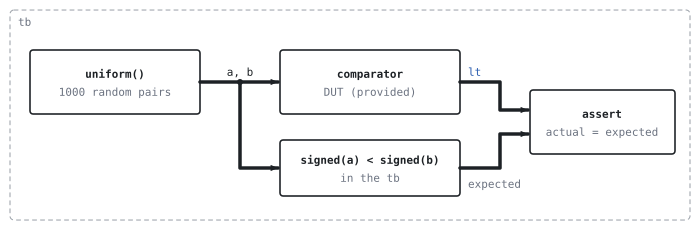

# 14.7 tb_random

**New concept:** `ieee.math_real.uniform` for constrained-random stimulus.

`ieee.math_real` provides `uniform(seed1, seed2, x)`, which returns a real `x` in
(0, 1) and updates the two seed variables. Scale it to get integers:

```vhdl
use ieee.math_real.all;
...
variable s1, s2 : positive := 42;
variable r      : real;
...
uniform(s1, s2, r);
v := to_signed(integer(floor(r * 256.0)) - 128, 8);     -- -128 .. 127
```

Random tests find the bugs you didn't think of; a reference model computes the
expected result for whatever came out.

**How this is graded:** the grader runs your `tb` once with the correct design, where
it must not report any `error` or `failure`, and once with each of several buggy
*mutants* of the design, where it must report at least one. Mutants your testbench
doesn't catch are listed as SURVIVED.

**Coming from Verilog:** `$random` / `$urandom` become `uniform` with explicit seed variables.

## Task

Test the provided 16-bit signed comparator (`lt = '1'` when `a < b` as signed) with 1000 random vectors, checking each against `signed(a) < signed(b)` computed in the testbench.



## Provided

```vhdl
entity cmp16 is
  port (a, b : in std_logic_vector(15 downto 0); lt : out std_logic);
end entity cmp16;
```

There are 3 mutants, each wrong only around the sign bit.

## Hints

<details><summary>Hint 1</summary>

`integer(floor(r * 65536.0))` gives 0–65535; convert with `to_unsigned(..., 16)`.

</details>

## Check

```
./check.py 14.7
```
