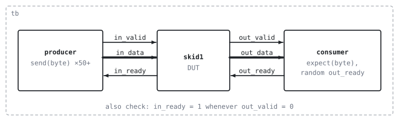

# 14.8 tb_handshake

**New concept:** testbench procedures for bus transactions.

Bus-level testbenches wrap the signal wiggling in procedures, so the test reads as
transactions. A procedure declared in a process can drive that process's signals
and wait:

```vhdl
procedure write_reg(addr : natural; val : std_logic_vector(7 downto 0)) is
begin
  wr_addr <= std_logic_vector(to_unsigned(addr, 4));
  wr_data <= val;
  wr_en   <= '1';
  wait until rising_edge(clk);
  wr_en   <= '0';
end procedure;
```

For a valid/ready interface, a sender holds `valid` and the data until it sees
`ready` at a rising edge, and a receiver checks data only on edges where both
`valid` and `ready` are high. Randomizing `ready` (backpressure) exposes bugs that
a always-ready consumer never sees.

**How this is graded:** the grader runs your `tb` once with the correct design, where
it must not report any `error` or `failure`, and once with each of several buggy
*mutants* of the design, where it must report at least one. Mutants your testbench
doesn't catch are listed as SURVIVED.

**Coming from Verilog:** Same as Verilog `task`s that wait on clock edges.

## Task

Test the provided one-entry buffer `skid1` (the 11.8 design) with a
`procedure send(byte)` in a producer process and a `procedure expect(byte)` in a
consumer process that randomizes `out_ready`. Send at least 50 bytes and check
that every byte comes out exactly once, in order. Also check the handshake rule
from 11.8: `in_ready` must be `'1'` whenever the buffer is empty
(`out_valid = '0'`).



## Provided

```vhdl
entity skid1 is
  port (
    clk, reset, in_valid, out_ready : in  std_logic;
    in_data                         : in  std_logic_vector(7 downto 0);
    in_ready, out_valid             : out std_logic;
    out_data                        : out std_logic_vector(7 downto 0)
  );
end entity skid1;
```

There are 3 mutants.

## Hints

<details><summary>Hint 1</summary>

Drive inputs a little after the rising edge (or on the falling edge) and sample on the rising edge.

</details>

<details><summary>Hint 2</summary>

Give the consumer a timeout so a stuck design ends with an error instead of running until the stop time.

</details>

## Check

```
./check.py 14.8
```
