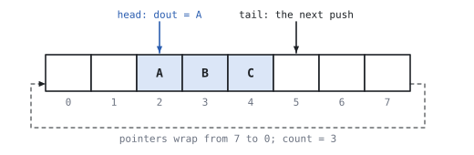

# 15.1 fifo_sync

**New concept:** a synchronous FIFO with first-word-fall-through.

A FIFO is a RAM plus a read pointer, a write pointer, and a count. With
**first-word fall-through** (FWFT), the head entry is already on `dout` whenever
the FIFO isn't empty, so `pop` acknowledges the data you're looking at rather
than requesting new data.

Corner cases are the whole job: simultaneous push and pop, full, empty. Decide
each one explicitly.

**Coming from Verilog:** Same design; the RAM is an array signal.

## Task

`generic (DEPTH : positive := 8; W : positive := 8)` (the ports are fixed at the
defaults). At each rising edge:

- `push = '1'` and not full: write `din` at the tail
- `pop = '1'` and not empty: remove the head
- both are evaluated against the state *before* the edge, so a push and a pop in
  the same cycle both happen when the FIFO is neither empty nor full; when it's
  full only the pop happens, and when it's empty only the push happens

Outputs: `dout` shows the head entry when not empty and `x"00"` when empty;
`empty`, `full`, and `count` (0–8) reflect the current contents. Active-high
synchronous `reset` empties the FIFO.



## Ports

```vhdl
entity top_module is
  generic (
    DEPTH : positive := 8;
    W : positive := 8
  );
  port (
    clk, reset, push, pop : in  std_logic;
    din                   : in  std_logic_vector(7 downto 0);
    dout                  : out std_logic_vector(7 downto 0);
    full, empty           : out std_logic;
    count                 : out std_logic_vector(3 downto 0)
  );
end entity top_module;
```

## Hints

<details><summary>Hint 1</summary>

Keep `count` as an integer `0 to DEPTH`; `empty` and `full` follow from it.

</details>

<details><summary>Hint 2</summary>

Pointers wrap with `mod DEPTH`.

</details>

## Check

```
./check.py 15.1
```
