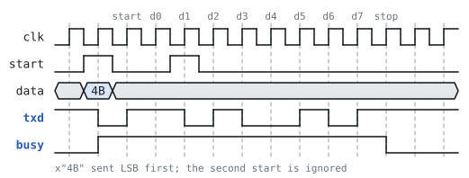

# 15.2 uart_tx

**New concept:** a serial transmitter: shift register plus bit counter.

The transmit side of 11.7: load a frame, shift it out one bit per clock, and tell
the producer when you're busy.

**Coming from Verilog:** Same.

## Task

One clock per bit. An edge with `start = '1'` while idle captures `data`; during
the next 10 cycles `txd` carries the start bit `'0'`, the 8 data bits LSB first,
and the stop bit `'1'`, and `busy = '1'` for all 10. Then the transmitter is idle
again: `busy = '0'`, `txd = '1'`. `start` is ignored while `busy = '1'`. Both
outputs are registered. Active-high synchronous `reset` → idle.



## Ports

```vhdl
entity top_module is
  port (
    clk, reset, start : in  std_logic;
    data              : in  std_logic_vector(7 downto 0);
    txd, busy         : out std_logic
  );
end entity top_module;
```

## Hints

<details><summary>Hint 1</summary>

A 10-bit shift register holding `'1' & data & '0'`, shifted right each cycle, makes `txd` its bit 0.

</details>

## Check

```
./check.py 15.2
```
