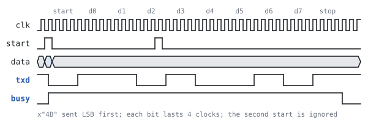

# 15.3 uart_tx_baud

**New concept:** a generic baud-rate divider.

Real UARTs run much slower than the clock. A counter that wraps every
`CLKS_PER_BIT` cycles produces the bit-time tick, and the 15.2 logic only advances
on that tick.

**Coming from Verilog:** `parameter CLKS_PER_BIT` becomes a generic.

## Task

Same as 15.2, but each bit lasts `CLKS_PER_BIT` clock cycles, with
`generic (CLKS_PER_BIT : positive := 4)`. `busy` is high for `10 × CLKS_PER_BIT`
cycles. The bit timer starts at the edge that accepts `start`.



## Ports

```vhdl
entity top_module is
  generic (
    CLKS_PER_BIT : positive := 4
  );
  port (
    clk, reset, start : in  std_logic;
    data              : in  std_logic_vector(7 downto 0);
    txd, busy         : out std_logic
  );
end entity top_module;
```

## Hints

<details><summary>Hint 1</summary>

A cycle counter `0 to CLKS_PER_BIT - 1`; shift and count bits when it wraps.

</details>

## Check

```
./check.py 15.3
```
