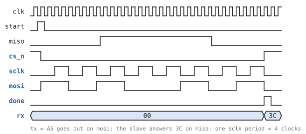

# 15.4 spi_master

**New concept:** generating a slower interface clock and aligning data to its edges.

SPI mode 0: the clock idles low, data changes while `sclk` is low, and both sides
sample on the **rising** edge of `sclk`. Inside an FPGA, `sclk` is just a
registered output toggled by a counter; it is never used as a clock.

**Coming from Verilog:** Same.

## Task

`sclk` runs at clk/4. While idle: `cs_n = '1'`, `sclk = '0'`, `mosi = '0'`,
`done = '0'`.

An edge with `start = '1'` while idle captures `tx`, sets `cs_n = '0'` and puts
`tx(7)` on `mosi`. The transfer then lasts 32 cycles, numbered `c = 0 … 31` from
the cycle after that edge:

```
c        : 0  1  2  3  4  5  6  7  ...  28 29 30 31 | idle
sclk     : 0  0  1  1  0  0  1  1  ...   0  0  1  1 |  0
mosi     : b7 b7 b7 b7 b6 b6 b6 b6 ...  b0 b0 b0 b0 |  0
cs_n     : 0  0  0  0  0  0  0  0  ...   0  0  0  0 |  1
done     : 0  0  0  0  0  0  0  0  ...   0  0  0  0 |  1 (one cycle)
```

- `miso` is sampled at the clock edge that ends cycle `c = 4k + 1` (where `sclk`
  rises), MSB first.
- At the edge that ends cycle 31, `cs_n` returns to `'1'`, `done` is `'1'` for
  one cycle, and `rx` takes the received byte (it holds until the next
  completion).

`start` is ignored while `cs_n = '0'`. All outputs are registered. Active-high
synchronous `reset` → idle, `rx = x"00"`.



## Ports

```vhdl
entity top_module is
  port (
    clk, reset, start, miso : in  std_logic;
    tx                      : in  std_logic_vector(7 downto 0);
    sclk, mosi, cs_n, done  : out std_logic;
    rx                      : out std_logic_vector(7 downto 0)
  );
end entity top_module;
```

## Hints

<details><summary>Hint 1</summary>

One counter `0 to 31` gives everything: `sclk` is bit 1 of the next count.

</details>

<details><summary>Hint 2</summary>

Shift `tx` left when `sclk` falls; shift `miso` in when it rises.

</details>

## Check

```
./check.py 15.4
```
