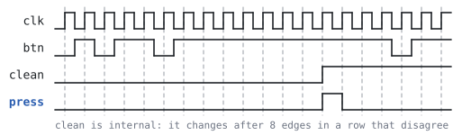

# 15.5 debounce_edge

**New concept:** composing two earlier designs.

Real designs are mostly compositions of small, well-tested pieces. This one is
11.6 (with a longer window) followed by 8.5.

**Coming from Verilog:** Same.

## Task

Debounce `btn` like 11.6, but `clean` only changes at the **8th** consecutive edge
where `btn` differs from it. Output `press = '1'` for exactly one cycle each time
`clean` goes from `'0'` to `'1'`: `press` rises at the same edge as `clean`.
`clean` itself is internal. Active-high synchronous `reset` → `clean = '0'`,
`press = '0'`, counter restarted.



## Ports

```vhdl
entity top_module is
  port (
    clk, reset, btn : in  std_logic;
    press           : out std_logic
  );
end entity top_module;
```

The grader drives `btn` with bouncy runs of 1–20 cycles.

## Hints

<details><summary>Hint 1</summary>

`press` is set at the same edge that flips `clean` to `'1'`, and cleared at every other edge.

</details>

## Check

```
./check.py 15.5
```
