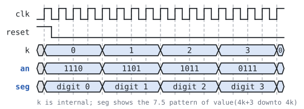

# 15.6 seven_seg_mux

**New concept:** time-multiplexed display (like the Nexys A7's 8-digit display).

Multi-digit 7-segment displays share the segment lines between digits. The design
enables one digit at a time (active-low anodes) and shows that digit's pattern,
cycling fast enough that the eye sees all digits lit at once.

**Coming from Verilog:** Same.

## Task

Show the 16-bit `value` on 4 digits. Digit `k` shows `value(4k+3 downto 4k)` using
the 7.5 encoding (active-low, `seg(6 downto 0) = g f e d c b a`). A digit counter
`k` advances every 4 clocks (0, 1, 2, 3, 0, …). `an(k) = '0'` for the active
digit and `'1'` for the others.

`an` and `seg` are combinational from `k` and the current `value`. Active-high
synchronous `reset` → digit 0 at the start of its 4-cycle slot.



## Ports

```vhdl
entity top_module is
  port (
    clk, reset : in  std_logic;
    value      : in  std_logic_vector(15 downto 0);
    an         : out std_logic_vector(3 downto 0);
    seg        : out std_logic_vector(6 downto 0)
  );
end entity top_module;
```

## Hints

<details><summary>Hint 1</summary>

Reuse your 7.5 glyph table; the digit counter is the top two bits of a 4-bit counter.

</details>

## Check

```
./check.py 15.6
```
