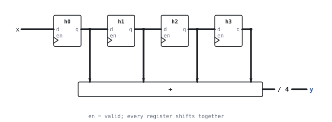

# 15.7 moving_avg4

**New concept:** a DSP-style sliding window.

A moving average keeps the last N samples in a shift register. With N a power of
two, the division is a shift. Mind the width of the sum: four 8-bit values need 10
bits.

**Coming from Verilog:** Same.

## Task

Keep the last 4 accepted samples. At each edge with `valid = '1'`, shift `x` into
the history. `y` is `(sum of the 4 history samples) / 4` rounded down, computed
combinationally from the history (so it changes after the edge that accepts a
sample). Active-high synchronous `reset` clears the history to 0.



## Ports

```vhdl
entity top_module is
  port (
    clk, reset, valid : in  std_logic;
    x                 : in  std_logic_vector(7 downto 0);
    y                 : out std_logic_vector(7 downto 0)
  );
end entity top_module;
```

## Hints

<details><summary>Hint 1</summary>

A 10-bit sum, then `y <= sum(9 downto 2)`.

</details>

## Check

```
./check.py 15.7
```
