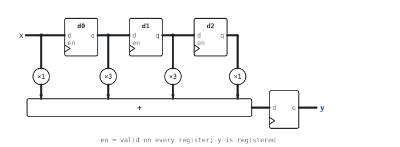

# 15.8 fir4

**New concept:** a constant-coefficient FIR filter.

A finite impulse response filter is a weighted sum of the last few samples. With
small constant coefficients, synthesis turns the multiplications into shifts and
adds (`3·x = 2x + x`).

**Coming from Verilog:** Same; watch the signed widths.

## Task

4-tap FIR with coefficients `(1, 3, 3, 1)` on 8-bit signed samples. Keep a delay
line `d0, d1, d2` of the previous accepted samples (`d0` newest). At each edge
with `valid = '1'`:

- `y ← x + 3·d0 + 3·d1 + d2` (11-bit signed; it can't overflow)
- the delay line shifts: `d2 ← d1`, `d1 ← d0`, `d0 ← x`

When `valid = '0'` nothing changes. `y` is registered. Active-high synchronous
`reset` clears the delay line and `y` to 0.



## Ports

```vhdl
entity top_module is
  port (
    clk, reset, valid : in  std_logic;
    x                 : in  std_logic_vector(7 downto 0);
    y                 : out std_logic_vector(10 downto 0)
  );
end entity top_module;
```

## Hints

<details><summary>Hint 1</summary>

`resize` every term to 11 bits before adding; `3 * d` on an 11-bit `signed` gives 22 bits, so `resize` the product too (or write `d + d + d`).

</details>

## Check

```
./check.py 15.8
```
