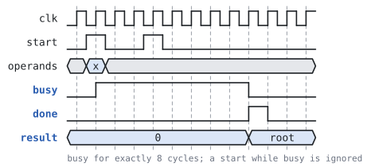

# 15.9 isqrt_seq

**New concept:** an iterative datapath with a start/busy/done handshake.

Some functions are too big to compute in one cycle, so you compute one bit per
cycle and handshake with the user. Bit-by-bit square root: for each result bit,
from the top, tentatively set it and keep it if the square still fits.

Timing, shared by the iterative units in this section: an edge with `start = '1'`
while idle captures the operands. `busy` is then `'1'` for exactly 8 cycles. At the edge
that ends the last busy cycle, the result outputs update and `done` is `'1'` for the next
cycle only. The result outputs hold their value until the next completion. `start` is
ignored while `busy = '1'` (it is accepted again in the `done` cycle). Active-high
synchronous `reset` → idle, results 0, `done = '0'`.

**Coming from Verilog:** Same.

## Task

`root = floor(sqrt(x))` for the 16-bit unsigned `x` captured at start, computed over 8 busy cycles (one result bit per cycle).



## Ports

```vhdl
entity top_module is
  port (
    clk, reset, start : in  std_logic;
    x                 : in  std_logic_vector(15 downto 0);
    root              : out std_logic_vector(7 downto 0);
    busy, done        : out std_logic
  );
end entity top_module;
```

## Hints

<details><summary>Hint 1</summary>

Keep a partial root `r`. In the step for bit `b`: `t := r or (bit b)`; if `t * t <= x` then `r := t`.

</details>

<details><summary>Hint 2</summary>

`t * t` on an 8-bit `unsigned` is 16 bits, the same width as `x`.

</details>

## Check

```
./check.py 15.9
```
