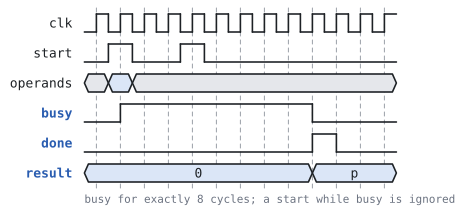

# 15.10 mult_seq

**New concept:** shift-and-add multiplication.

The hardware version of long multiplication: for each bit of the multiplier, add
the shifted multiplicand to an accumulator if the bit is 1.

Timing, shared by the iterative units in this section: an edge with `start = '1'`
while idle captures the operands. `busy` is then `'1'` for exactly 8 cycles. At the edge
that ends the last busy cycle, the result outputs update and `done` is `'1'` for the next
cycle only. The result outputs hold their value until the next completion. `start` is
ignored while `busy = '1'` (it is accepted again in the `done` cycle). Active-high
synchronous `reset` → idle, results 0, `done = '0'`.

**Coming from Verilog:** Same.

## Task

`p = a × b` (8×8 unsigned → 16 bits) for the operands captured at start, computed over 8 busy cycles.



## Ports

```vhdl
entity top_module is
  port (
    clk, reset, start : in  std_logic;
    a, b              : in  std_logic_vector(7 downto 0);
    p                 : out std_logic_vector(15 downto 0);
    busy, done        : out std_logic
  );
end entity top_module;
```

## Hints

<details><summary>Hint 1</summary>

Shift the multiplier right and the multiplicand left each cycle.

</details>

## Check

```
./check.py 15.10
```
