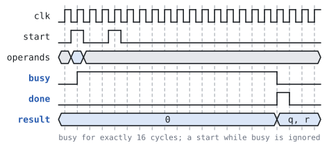

# 15.11 div_seq

**New concept:** restoring division.

Restoring division brings down one dividend bit per cycle into a partial
remainder, subtracts the divisor if it fits, and records a quotient bit.

Timing, shared by the iterative units in this section: an edge with `start = '1'`
while idle captures the operands. `busy` is then `'1'` for exactly 16 cycles. At the edge
that ends the last busy cycle, the result outputs update and `done` is `'1'` for the next
cycle only. The result outputs hold their value until the next completion. `start` is
ignored while `busy = '1'` (it is accepted again in the `done` cycle). Active-high
synchronous `reset` → idle, results 0, `done = '0'`.

**Coming from Verilog:** Same.

## Task

Divide the 16-bit unsigned `n` by the 8-bit unsigned `d` (captured at start) over
16 busy cycles: `q = n / d`, `r = n mod d`, `dz = '0'`.

Dividing by zero takes the same 16 cycles and gives `q = x"FFFF"`,
`r = n(7 downto 0)` and `dz = '1'`. `dz` updates and holds together with `q` and `r`.



## Ports

```vhdl
entity top_module is
  port (
    clk, reset, start : in  std_logic;
    n                 : in  std_logic_vector(15 downto 0);
    d                 : in  std_logic_vector(7 downto 0);
    q                 : out std_logic_vector(15 downto 0);
    r                 : out std_logic_vector(7 downto 0);
    busy, done, dz    : out std_logic
  );
end entity top_module;
```

## Hints

<details><summary>Hint 1</summary>

The partial remainder needs 9 bits: shift in one dividend bit, compare against `d`, subtract if it fits.

</details>

## Check

```
./check.py 15.11
```
