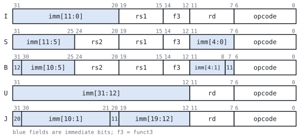

# 15.13 rv32i_imm_gen

**New concept:** immediate formats: the bit-scrambling that makes RISC-V decoders small.

RISC-V keeps the sign bit of every immediate at `instr(31)` and reuses bit
positions across formats, so the immediate generator is just muxed slices. The
B and J formats encode multiples of 2, so bit 0 is always 0.

**Coming from Verilog:** Same slices and concatenations.

## Task

Generate the 32-bit sign-extended immediate from `instr`, choosing the format from
the opcode `instr(6 downto 0)`:

| opcode | format | immediate |
|---|---|---|
| `0000011` (load), `0010011` (op-imm), `1100111` (jalr) | I | `instr[31:20]` |
| `0100011` (store) | S | `instr[31:25] & instr[11:7]` |
| `1100011` (branch) | B | `instr[31] & instr[7] & instr[30:25] & instr[11:8] & '0'` |
| `0110111` (lui), `0010111` (auipc) | U | `instr[31:12] & x"000"` |
| `1101111` (jal) | J | `instr[31] & instr[19:12] & instr[20] & instr[30:21] & '0'` |
| anything else | — | 0 |

I, S, B and J immediates are sign-extended from their top bit (always `instr(31)`).



## Ports

```vhdl
entity top_module is
  port (
    instr : in  std_logic_vector(31 downto 0);
    imm   : out std_logic_vector(31 downto 0)
  );
end entity top_module;
```

The grader biases `instr` toward valid RV32I opcodes.

## Hints

<details><summary>Hint 1</summary>

A `case` on the opcode; each branch is one concatenation with `(n downto 0 => instr(31))` for the sign extension.

</details>

## Check

```
./check.py 15.13
```
