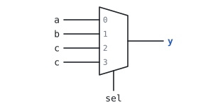

# 16.1 bug_sensitivity

**New concept:** debugging a combinational process.

This file is a complete design that compiles, but it has a bug. The task below says what
the design is **supposed** to do. Find the bug with the grader and the waveform, and fix
it, changing as little as possible.

**Coming from Verilog:** Bugs like this one exist in Verilog too; the VHDL symptoms are what's worth learning to recognize.

## Task

A 3-input mux: `y = a` when `sel = "00"`, `b` when `sel = "01"`, and `c` otherwise.



## Ports

```vhdl
entity top_module is
  port (
    sel     : in  std_logic_vector(1 downto 0);
    a, b, c : in  std_logic;
    y       : out std_logic
  );
end entity top_module;
```

The grader changes one input at a time and checks after each change.

## Hints

<details><summary>Hint 1</summary>

When does this process run? Watch the waveform when only `c` changes.

</details>

## Check

```
./check.py 16.1
```
