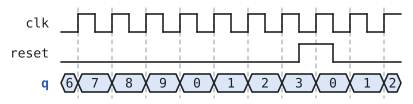

# 16.6 bug_off_by_one

**New concept:** debugging a counter.

This file is a complete design that compiles, but it has a bug. The task below says what
the design is **supposed** to do. Find the bug with the grader and the waveform, and fix
it, changing as little as possible.

**Coming from Verilog:** Bugs like this one exist in Verilog too; the VHDL symptoms are what's worth learning to recognize.

## Task

A decade counter `q`: 0–9, wrapping to 0. Active-high synchronous `reset` to 0.



## Ports

```vhdl
entity top_module is
  port (
    clk, reset : in  std_logic;
    q          : out std_logic_vector(3 downto 0)
  );
end entity top_module;
```

## Hints

<details><summary>Hint 1</summary>

List the values `q` takes after a reset.

</details>

## Check

```
./check.py 16.6
```
